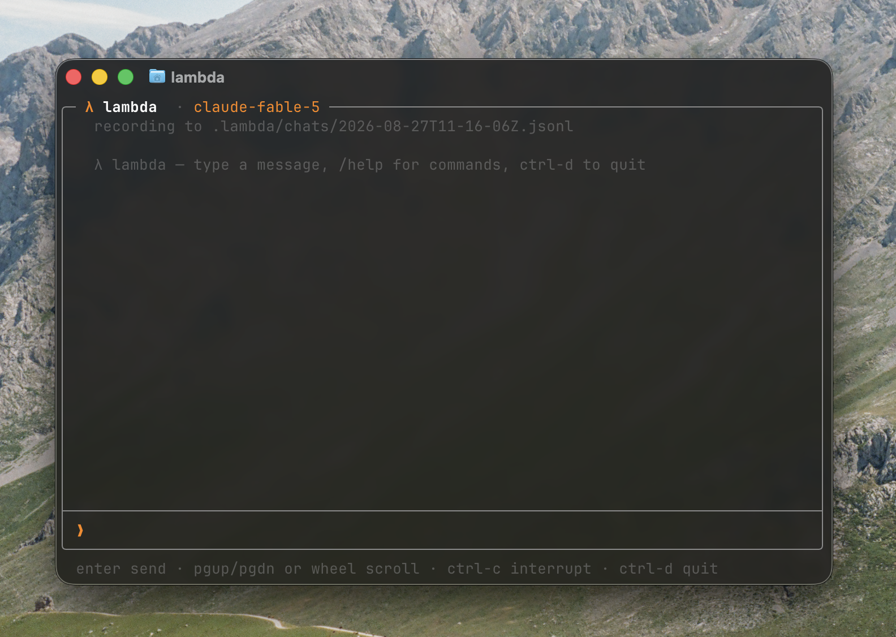

# λ lambda

extremely fast portable agent harness in c.



* fixed-frame tui, scrolls internally, markdown incl. tables
* portable and statically linked
* full conversation history in memory, with model-sized initial storage
* single-file c plugins (exa web search included)
* every chat saved as resumable ndjson
* optional streaming voice output through Inworld TTS
* native herdr state reporting and session restore

## build

```sh
make            # → ./lambda
make release    # dead-stripped, symbols removed (~251 kb)
make install    # → $(PREFIX)/bin, default /usr/local
make uninstall
make test       # unit tests under asan/ubsan
make uitest     # terminal render + scroll checks (needs python + pyte)
make apitest    # LiteLLM protocol + picker checks (python stdlib, local socket)
make contexttest # automatic summaries, context recovery, resume (python stdlib)
make herdrtest   # herdr lifecycle + resume checks (python stdlib, local sockets)
make historytest # full transcript retention, large replies, allocation failure
make STATIC=1   # static binary (best with musl-gcc)
make DEBUG=1    # asan/ubsan
```

c99 compiler and gnu make. nothing else.

`install` honours `PREFIX`, `BINDIR`, `DESTDIR`.

## use

```sh
export ANTHROPIC_API_KEY=sk-ant-...

lambda                      # tui
lambda -p "explain memfd"   # one-shot
echo "prompt" | lambda      # one-shot from stdin
lambda resume               # continue the last chat
lambda resume FILE          # continue a specific one
```

| flag | |
|---|---|
| `-m MODEL` | model for this run; otherwise use the saved choice or first-run picker |
| `--litellm URL` | use a LiteLLM proxy; accepts http/https and an optional `/v1` suffix |
| `--anthropic` | use Anthropic directly, ignoring saved LiteLLM config |
| `--models` | print available model ids and exit |
| `--max-tokens N` | output limit (4096 through LiteLLM, 64000 direct) |
| `--context-window N` | override automatic context-window detection |
| `-s SYSTEM` | system prompt |
| `-p PROMPT` | one-shot, then exit |
| `-e EFFORT` | reasoning effort for this run; `default` leaves it to the provider |
| `-r FILE` / `-c` | same as `resume FILE` / `resume` |
| `--no-thinking` | hide reasoning |
| `--voice` | speak replies through a local audio player |
| `--voice-id ID` | override the Inworld voice for this run |
| `--no-tools` | disable bash |
| `--no-log` | don't record |
| `--no-context` | ignore `AGENTS.md` / `CLAUDE.md` |
| `--no-fallback` | disable refusal fallbacks |

commands: `/model`, `/models`, `/context`, `/compact`, `/system`, `/effort`, `/thinking`, `/voice`, `/tools`, `/clear`,
`/help`, `/quit`.

bare `/model` opens a picker over the transcript — type to filter, arrows or
page keys to move, enter to switch, esc to cancel. ctrl-u clears the filter.
lists of nine or fewer models also accept `1`–`9` as selection shortcuts.
`/model ID` sets any id directly, whether or not it is on the list.

keys: enter sends. mouse wheel/trackpad or pgup/pgdn scroll the conversation.
scrolling up holds your position while replies and tool output arrive;
scroll back to the bottom to follow new output again. ctrl-c interrupts a reply or a
running command. ctrl-d quits. ctrl-a/e/k/u/w edit, up/down for history.

shift-drag to select text in terminals that support it, then use your terminal's
copy/paste shortcuts. bracketed paste keeps multiline text in the input until
you press enter. `LAMBDA_MOUSE=0 lambda` disables mouse capture for native
drag selection; pgup/pgdn still scroll the conversation.

the input stays live while the model works — enter queues instead of
interrupting. queued prompts show above the input marked `»` and run in order.
after an error or ctrl-c, queued prompts pause. press enter with empty input
to resume them. a full queue keeps the unsent draft in the editor.

piped or redirected it drops the tui and streams plain text to stdout.
`NO_COLOR` disables styling there.

## herdr

run `lambda` in a [herdr](https://herdr.dev/tui/docs/add-herdr-support/) pane.
it reports its name and state automatically; no plugin or wrapper is needed.

* `idle`: ready for input.
* `working`: generating a reply, running tools, compacting or fetching models.
* `blocked`: selecting a model, a failed turn, or queued prompts paused after
  an error or interrupt. the report includes a short explanation.

quitting releases the pane. cancelling a turn without queued prompts returns
to idle; successful queued turns stay working until the queue is drained.

with herdr 0.9.2 or later, recorded sessions also report a resume command.
after a herdr restart, it runs `lambda -r /absolute/path/to/transcript` with
the current model, reasoning effort, provider, tool and display settings,
voice settings, and explicit token/context limits. system prompts stay in the
transcript. install `lambda` on `PATH` (`make install`) so herdr can launch it.
credentials continue to come from lambda's environment or config file.

`--no-log` sessions cannot restore. if a resume argument contains an apostrophe
or control character, or the command exceeds herdr's 8 kib limit, lambda omits
the resume command and continues reporting state.

the integration activates only with `HERDR_ENV=1` and nonempty
`HERDR_PANE_ID`, `HERDR_BIN_PATH` and `HERDR_SOCKET_PATH`. it uses herdr's
documented Unix socket API with static buffers, no helper process or thread,
and a 50 ms total timeout per report. failures are silent; the next state
change tries again. outside herdr it does nothing.

verified with herdr 0.9.5 on linux: native state detection, a server restart
that restored the same transcript and prior messages, and release on quit.
the check used an isolated herdr session and a local model fixture.

## voice output

install a streaming MP3 player on the machine running lambda. macOS:

```sh
brew install mpv
export INWORLD_VOICE_ID=sparkly-palm-9744__alan_bennett_1
lambda --voice
```

set `INWORLD_API_KEY` in that machine's environment or secret manager first.
create a key in the [Inworld Portal](https://platform.inworld.ai) if needed.
lambda sends it unchanged as `Authorization: Basic <key>`. it is never
written to settings, transcripts, player arguments, or error messages, and
is removed from the audio player's environment.

`/voice` toggles speech; `/voice on`, `/voice off`, and `/voice stop` are
also accepted. stop cancels current playback while keeping voice enabled
for the next reply. ctrl-c stops speech immediately, including after text
has finished. a new prompt cancels any previous audio. one-shot mode waits
for playback before exiting. text output stays available if synthesis fails.

the voice can also be saved in `~/.config/lambda/voice.json` (or
`$XDG_CONFIG_HOME/lambda/voice.json`):

```json
{"voice_id": "sparkly-palm-9744__alan_bennett_1"}
```

`--voice-id` overrides `INWORLD_VOICE_ID`, which overrides the saved voice.
with no voice configured, the default is Sarah. synthesis uses `inworld-tts-2`,
MP3, speaking rate 1, `BALANCED` delivery and `AUTO` language.

speech starts while text is still arriving. complete sentences and newlines
flush immediately; shorter unfinished phrases buffer for at most 400 ms,
even while text keeps arriving. long phrases split at whitespace or a complete UTF-8 character, up to
1,200 bytes per request. each request uses Inworld's
[HTTP streaming endpoint](https://docs.inworld.ai/api-reference/ttsAPI/texttospeech/synthesize-speech-stream.md);
audio chunks are decoded and played as they arrive. only live assistant text
is spoken, including its markdown; reasoning, tool output, internal memory
summaries and restored history are excluded.

playback uses the first available player in this order: `mpv`, `mpg123`,
`ffplay`. it runs in a separate process so typing and model output stay
responsive. pending text is bounded to 1 MiB; exceeding that stops speech
for the reply and reports an error. audio stays in pipes and memory.
over SSH, sound plays on the remote host. run lambda locally on your Mac
to hear it there. voice mode is opt-in and is not restored from transcripts.

## litellm

save your proxy URL and a virtual key in `~/.config/lambda/config.json`
(or `$XDG_CONFIG_HOME/lambda/config.json`):

```json
{
  "base_url": "http://localhost:4000",
  "api_key": "sk-your-lambda-virtual-key"
}
```

keep this file private (`chmod 600 ~/.config/lambda/config.json`). lambda
loads it automatically. credentials stay out of transcripts.

environment variables override the saved settings:

```sh
export LITELLM_BASE_URL=http://localhost:4000
export LITELLM_API_KEY=sk-your-lambda-virtual-key

lambda                        # pick a model once, then reuse the saved choice
lambda --models               # print the catalog
lambda -m local/qwen3.8-27b -p "hello"
lambda --anthropic            # use the direct Anthropic connection
```

`LITELLM_PROXY_URL` is an alias for `LITELLM_BASE_URL`. `--litellm URL`
overrides the URL for one run. an empty `LITELLM_API_KEY` disables proxy
authentication; Anthropic credentials are never sent to LiteLLM.

lambda fetches `/v1/models`, sorts and deduplicates the ids, and shows the
full returned list with a search filter. `/models` refreshes the catalog;
`/model` refreshes and opens the picker. a failed refresh keeps the last good
list. the fixed catalog holds up to 1024 models; larger lists fail explicitly.
the proxy may list image, embedding, or retired models: choose a model that
supports chat (and tool calling when using tools).

on the first interactive launch, lambda asks you to select a model, then asks
for reasoning effort when the model advertises controls. confirming both saves
the pair as the default for future launches. `/model` and `/model ID` repeat this
flow; cancelling either picker leaves the current and saved settings unchanged.
`/effort` opens the effort picker for the current model; `/effort high` changes
and saves it directly. `default` is a saved choice too, so lambda will not ask
again on every launch.

the choice is stored in `~/.config/lambda/default-model` (or under
`$XDG_CONFIG_HOME/lambda`). direct Anthropic uses `default-model-anthropic`
in the same directory. each private file contains the model id on the first line
and `effort=high` (or `effort=default`, etc.) on the second, written atomically.
credentials and other config are left untouched. older model-only files still
load and ask for effort on the next interactive launch. delete the relevant
file to ask again. if saving fails, lambda reports it and keeps the selection
for the current chat.

an explicit `-m`, resumed model or saved default skips the startup picker, in
that order of precedence. `-m`, `-e` and resume do not overwrite the saved default.
an explicit `-e` overrides the saved or resumed effort; `-m` starts the newly
specified model at its provider default unless paired with `-e`.
lambda fetches metadata to size its initial storage; unavailable metadata uses conservative
defaults. without a saved default, one-shot mode requires `-m` when the proxy
offers more than one model.
model selection is recorded in the transcript and restored on resume.

chat uses LiteLLM's [unified messages endpoint](https://docs.litellm.ai/docs/anthropic_unified/),
which translates streaming replies and tool calls across providers. switching
models keeps text and tool history, dropping thinking signatures from other
models. overlapping text, thinking and tool blocks are tracked by their stream
indexes so an answer cannot be saved as reasoning. direct Anthropic fallback
options are omitted for the proxy. `/thinking` only controls whether returned
reasoning is shown. `--max-tokens` adjusts the
proxy's 4096-token default output limit.

### reasoning discovery

lambda reads LiteLLM's `/model_group/info` and `/model/info` under the configured
proxy prefix. it joins entries by model alias, rather than guessing from the
alias name. group `supported_reasoning_efforts` and deployment
`reasoning_effort_levels` supply explicit ladders; deployment flags constrain
them, and `thinking_always_on` removes `none`. aliases with several deployments
use their common levels. `default_reasoning_effort` is shown as a hint;
choosing `default` omits reasoning parameters and lets the proxy decide.

when no ladder is provided but metadata advertises both reasoning and the
`reasoning_effort` parameter, lambda offers the common low/medium/high levels
plus any explicitly advertised extensions. unknown capabilities or unavailable
metadata keep the provider default with a notice. unsupported levels advertised
by neither the model nor its deployments are not offered. `/models` refreshes
the capability cache as well as the model list.

selected effort is sent on `/v1/messages` as `thinking.type=adaptive` with
`output_config.effort`. LiteLLM translates this for native adaptive models,
legacy Anthropic thinking budgets, and other providers. `none` uses disabled
thinking for native Anthropic-compatible models, and effort `none` for
translated models. the common `minimal` tier maps to `low` for native Anthropic models.
older proxy versions may lack these translations; the
installed LiteLLM version was checked against its implementation. see
[LiteLLM reasoning](https://docs.litellm.ai/docs/reasoning_content) and
[Messages API](https://docs.litellm.ai/docs/anthropic_unified/).
for budget-based reasoning, `--max-tokens` covers both thinking and the answer;
allow enough output tokens for both.

## automatic conversation memory

lambda keeps every committed message in memory, including original text,
reasoning and captured tool results. scrollback also grows without evicting
old items. a model switch keeps the complete history, including when switching
to a smaller model. `--no-log` still retains the conversation in memory for
the lifetime of the process.

the model's context window limits what can be sent in one request. lambda
maintains a separate active selection of messages for that request. long chats
summarise older work in this selection, including during tool loops, at the
earlier of:

* 80% of the model's context window;
* the context window minus the reply allowance and a tool/safety reserve of
  12.5% of the window, capped at 8192 tokens.

LiteLLM's model metadata supplies context and output limits. the direct
Anthropic shortlist has built-in limits. unknown models use a conservative
32k window; `--context-window N` overrides it. the output allowance also stays
within the model's output limit and half its context window.

usage includes cached input tokens. local estimates account for system
instructions, project files, tool definitions, memory and messages; near the
threshold, lambda uses the provider's token-count endpoint when available.
if the provider still rejects a request for length, lambda reduces its working
limit, compacts and retries automatically.

the selected model writes a concise handoff of goals, constraints, decisions,
files, completed work, tool findings and next steps. recent messages and the
active user request stay verbatim when they fit. tool calls and results stay
paired. oversized histories are summarised in chunks, so switching to a smaller
model works too. summaries run without tools and only show a brief status while
the normal reply waits.

compaction never removes the original messages from memory or scrollback.
the complete transcript also stays on disk. a single `compact` record commits
the summary and active selection; resume restores that selection and reloads
all original messages into memory and scrollback, including compacted messages.
failed, interrupted or incomplete summaries leave the original history intact.
if a summary temporarily fails while there is still headroom, the normal request
continues. message count and allocated buffer capacity do not trigger compaction.

`/context` shows estimated token usage, the threshold, total retained message
count, stored/reserved history bytes and active message count. `/compact`
updates the model's working summary while retaining the originals. `/clear`
explicitly resets the conversation archive and summary; failed turns roll back
only uncommitted messages. older messages retained in memory are not all sent
to the model once its context has been compacted.

## model

the direct Anthropic fallback is claude fable 5, with `display: "summarized"` so reasoning streams
live in dim italic under a `✻` gutter. `--no-thinking` hides it.

`-e` overrides the reasoning setting for one run. saved selections restore it;
`-e default` leaves effort to the provider. available levels depend on the model.

fable costs ~2x the opus tier ($10/$50 vs $5/$25 per mtok) and needs 30-day
data retention — not available under zdr. `-m claude-opus-5` switches back.
thinking/effort params are only sent to models that accept them, so older ids
like `claude-haiku-4-5` still work.

`/model` lists these, with context window and price per mtok:

| id | ctx | in/out per mtok |
|---|---:|---|
| `claude-fable-5` | 1m | $10/$50, no zdr |
| `claude-opus-5` | 1m | $5/$25 |
| `claude-opus-4-8` | 1m | $5/$25 |
| `claude-sonnet-5` | 1m | $3/$15 |
| `claude-haiku-4-5` | 200k | $1/$5, provider default |

switching mid-chat keeps the history: thinking blocks replay to the model
that produced them and are dropped by the others.

refusal fallbacks are on by default for fable/opus-5: if a classifier
declines, the api retries on a fallback model in the same call and the status
line notes the switch. `--no-fallback` disables.

## markdown

headings, `**bold**`, `*italic*`, `` `code` ``, fenced blocks, bullets and
quotes are styled a line at a time as the reply streams.

inline links render as underlined `label (url)`, keeping the destination
visible for copying. list continuations align with their text, and formatting
and URL punctuation survive line wrapping.

tables are the exception: column widths depend on every row, so a whole
github-style table is laid out once the delimiter row arrives, then drawn
with box rules.

```
| model | ctx | price |
|---|:--:|------:|
| claude-opus-5 | 1m | $5/$25 |
```

alignment colons are honoured, cells wrap when they must, and the widest
column is shaved first to fit the frame. too narrow to draw at all and the
source text is shown instead.

## context files

walks from cwd up to `/` collecting `AGENTS.md` and `CLAUDE.md`, and puts them
at the head of the system prompt with a `cache_control` breakpoint. nearest
file wins. loaded paths print on the first line.

## transcripts

`./.lambda/chats/<timestamp>.jsonl`, one json object per line, written as the
chat happens:

```
{"t":"session","v":1,"time":"…","model":"claude-fable-5","cwd":"…"}
{"t":"msg","m":{"role":"user","content":"…"}}
{"t":"drop","n":1}
{"t":"meta","k":"model","v":"claude-opus-5"}
{"t":"compact","drop":40,"pin":-1,"summary":"goal, completed work, next steps…"}
{"t":"clear"}
```

`msg` holds the api message verbatim — text, thinking blocks with signatures,
`tool_use`, `tool_result`. completed reasoning stays with its original model.
reasoning-only replies are rejected without changing history; older saved
reasoning-only messages are skipped when building requests. a failed or
interrupted turn rolls back and writes `drop`.

concurrent starts atomically claim separate transcript files. a resumed
transcript is locked for the lifetime of its writer; a second process gets
a clear error instead of appending to the same history. close the first
process before resuming that transcript elsewhere.

writes are queued in memory and flushed only when idle, so they never block
the ui or a request. flushed records survive `kill -9`; buffered records may
not. transcript locks are released when the process exits or is killed.

## bash tool

runs `/bin/sh -c` in its own session and process group from the cwd.
stdout+stderr are merged and captured, truncated at 64 kb, with non-zero exit
reported to the model. stdin is `/dev/null`; tools have no controlling terminal,
so git/ssh helpers cannot reopen `/dev/tty` to write over the tui or read your
keystrokes. commands that require terminal input must use a noninteractive
alternative. no shell state persists between calls. ctrl-c signals the whole group.

**no approval prompt** — if claude decides to run something, it runs. don't
point it at a directory you'd mind it changing. `--no-tools` disables.

## plugins

one `.c` file in `plugins/`. the makefile globs the dir and each file
registers itself at startup — no registry, no codegen.

```c
#include "plugin.h"

static int run(const char *args_json, buf *out)
{
    buf_appends(out, "pong");
    return 0;
}

static const lambda_tool ping = {
    .name = "ping",
    .description = "reply with pong",
    .schema = "{\"type\":\"object\",\"properties\":{}}",
    .run = run,
};

LAMBDA_TOOL_REGISTER(ping)
```

`run` gets the raw input json (parse with `jsonx.h`) and writes the result
into `out`. optional: `available()` hides the tool when e.g. a key is missing,
`label()` sets the transcript line. `plugin_https_post()` reuses lambda's tls.

### exa

`plugins/exa.c` adds `exa_search`. set `EXA_API_KEY` to enable; without it the
tool isn't offered. returns highlights by default (cheap in tokens);
`full_text` for whole pages. `num_results` 1–25, plus `type` and `category`.

## memory allocation

history, request/reply buffers, scrollback and their indexes use growable
storage. selecting a model reserves an initial history and request capacity
of eight bytes per context token plus 64 kib. reply buffers use the same
estimate based on the effective output-token limit. capacities round up
geometrically, and existing allocations never shrink on a model switch.

token counts cannot specify a maximum byte size or total conversation length.
these are initial reservations, not limits: buffers grow as needed, and there
is no 512-message, 8 mib history or 4 mib scrollback cap. allocations happen
when reserving or growing capacity, rather than allocating one object per token.
memory use grows with retained conversation size and is ultimately limited
by available memory. allocation failures report an error and preserve existing
history; result storage is reserved before running tools.

protocol frames, individual tool captures, summaries and rendering scratch
space still have bounded buffers in `src/config.h`. libc can also allocate
internally for file handling and dns. lambda no longer claims zero explicit
heap allocations.

## memory comparison

historical measurement of the earlier fixed-buffer implementation, before
full history retention and growable storage. these numbers do not describe
memory growth in the current implementation.

measured on travis, linux x86-64, 2026-11-17: lambda 0.7.0 (the normal `make`
build, dynamically linked) and codex-cli 0.169.0. one fresh terminal session
each, running together in this repo with 120×40 terminals and local settings.

| measurement | lambda rss | codex rss | lambda pss | codex pss |
|---|---:|---:|---:|---:|
| idle before prompt, median | 28.1 mib | 281.8 mib | 26.5 mib | 195.7 mib |
| prompt window, sampled peak | 33.5 mib | 311.0 mib | 31.2 mib | 224.2 mib |
| idle after reply, median | 33.5 mib | 306.6 mib | 31.1 mib | 219.8 mib |
| whole run, sampled peak | 33.5 mib | 312.4 mib | 31.2 mib | 225.6 mib |

codex used 10.0× lambda's idle rss and 7.4× its idle pss in this run.
rss counts resident pages in full; pss divides shared pages among the
processes using them. mib means 1,048,576 bytes.

commands:

```sh
./lambda -m lyber/kimi-k31-pro-abliterated
codex --no-daemon --no-alt-screen -s read-only -a never
```

after startup, sampled idle memory for 38 seconds, sent each session
`Without using tools, reply with exactly: memory benchmark complete`, then
sampled for another 31 seconds after both replies finished. both returned
the requested text without tool calls. lambda used the configured LiteLLM
proxy; codex used `gpt-6-astra` with high reasoning effort.

read `/proc/<pid>/smaps_rollup` for each process and its recursive children,
sleeping 100 ms between scans (about 110 ms including collection). the monitor
is excluded. `--no-daemon` keeps codex's session in the measured process;
each tree contained one process at every sample. codex kept its configured
integrations and reported MCP startup failures for exa and notion; exa needed
OAuth reauthentication.

this is one short session with different remote models and local configuration.
it does not measure model-server memory, long conversations, or tool workloads;
sampling can miss brief peaks. [measurement details](benchmarks/memory-2026-11-17.json)
include versions, the lambda binary hash, sample counts and memory ranges.

## tls

bearssl has no os trust store, so root cas load from the first of:
`$SSL_CERT_FILE`, `/etc/ssl/certs/ca-certificates.crt`,
`/etc/pki/tls/certs/ca-bundle.crt`, `/etc/ssl/ca-bundle.pem`,
`/etc/ssl/cert.pem`. parsed lazily on first request.

## layout

```
src/
  main.c    args, repl, slash commands
  api.c     messages api, sse parsing, tool loop
  http.c    https client on bearssl + picohttpparser
  gateway.c LiteLLM config, URL routing, virtual-key auth, model discovery
  herdr.c   native pane state, transcript resume command, bounded local IPC
  ta.c      pem bundle → bearssl trust anchors
  tools.c   bash tool + dispatch
  plugin.c  plugin registry, shared https helper
  project.c AGENTS.md / CLAUDE.md discovery
  session.c ndjson transcripts, resume
  ui.c      transcript, wrapping, layout, line editor
  term.c    raw mode, alt screen, diffed cells, key decoding
  md.c      inline markdown → style flags
  jsonx.c   jsmn helpers
  util.c    fixed-capacity buffers
  config.h  all arena sizes
plugins/exa.c
vendor/     bearssl 0.6, jsmn, picohttpparser (all MIT)
```

the cell grid tracks display width, not codepoints — cjk and emoji take two
columns, so a wide glyph claims a continuation cell. without it the grid and
terminal disagree and stale glyphs linger when scrolling.

no termbox/curses: lambda uses ~5% of either, and termbox2 keeps pointers into
arrays it reallocs. raw mode + diffed grid + key decoding is ~450 lines.

## tests

`make test` builds `tests/` under asan and ubsan with small initial indexes and
table scratch storage. it checks growth without eviction, preservation across
compaction, model switches, rollback, and integer overflow in allocation sizes.
it also checks JSON/Unicode encoding, search excerpt boundaries, every split
point in HTTP and SSE fixtures, randomized stream chunks, and queue invariants.

`make uitest` covers the two display bugs that have actually shipped. it
replays term.c's own escape output through an independent terminal emulator
and checks the result matches term.c's back buffer — drift there is what
leaves stale glyphs, usually via wide characters. it then fires bursts of
scroll events faster than the repaint coalescing window and checks the
settled screen equals a forced full repaint, which catches a deferred frame
being stranded. `LAMBDA_SELFTEST_FILL=n` seeds the transcript so this runs
with no api key.

ci compiles with `-Werror` on gcc and clang across linux and macos, runs both
suites, and checks the static link.

`make apitest` runs the real binary against a local HTTP fixture. it checks
configuration precedence, credential isolation, catalogs larger than the old
picker limit, malformed responses, fragmented streams, a bash tool round trip,
resume after switching providers, failed-turn rollback, and TUI filtering.
it also checks recovery from incomplete reasoning and fragmented multiline paste.

`make sessiontest` checks concurrent starts, exclusive resume (including
alternate paths), and lock release on normal exit and process termination.

`make reliabilitytest` injects binary and truncated tool output, malformed
streams, invalid and excessive tool calls, provider errors after side effects,
and cancellation while a child has closed its output. real TUI processes check
FIFO queueing, capacity, and pause/resume with requests held at known points.
completed tool results survive later errors. unfinished calls recovered after
a process dies are marked as having unknown outcomes, so the model can inspect
state before retrying them. these checks use a local server and run in CI.

`make livetest` is an opt-in test against the configured LiteLLM service using
the two Lyber models. it makes paid API calls: 13 prompts per model cover
recall, file writes/reads/appends, markdown links, repeated resumes and model
switching, binary tool output and recall afterwards; four more prompts run
concurrent sessions in one directory. replies
and file contents are checked automatically. a JSON report and transcripts
are retained in the printed temporary directory. set `LAMBDA_TEST_BINARY` to
test an installed binary instead of `./lambda`. this is not run in CI.

`make contexttest` checks proactive compaction, multi-chunk summaries, repeated
resume, provider context errors, token-count fallback, cached usage, active tool
loops, pinned user requests, history capacity and failed-summary rollback.

`make herdrtest` uses local HTTP and Unix socket fixtures to check lifecycle
reports, changing settings, executable transcript restore, model selection,
errors, interrupted queues, and missing or unresponsive herdr servers.
it needs no herdr installation, provider credentials, or external network.

`make historytest` restores 5,000 original messages behind a compacted context,
round-trips a 1.2 mb streamed reply through disk and the next request, and
checks that an allocation failure leaves the existing transcript unchanged.
it uses a local provider fixture and no credentials.

`make reasoningtest` checks rich capability discovery, constrained effort
menus, cancellation, paired defaults, old preference migration, CLI/resume
precedence and the reasoning fields sent to the proxy. it uses local fixtures.

## limits

* width is per codepoint, so grapheme clusters (flag emoji, skin tones) sit a
  column off
* fresh dns/tcp/tls per turn (`Connection: close`) — a few hundred ms before
  the first token; keep-alive would fix it
* glibc static builds still dlopen nss for dns; use musl for a truly
  self-contained binary
